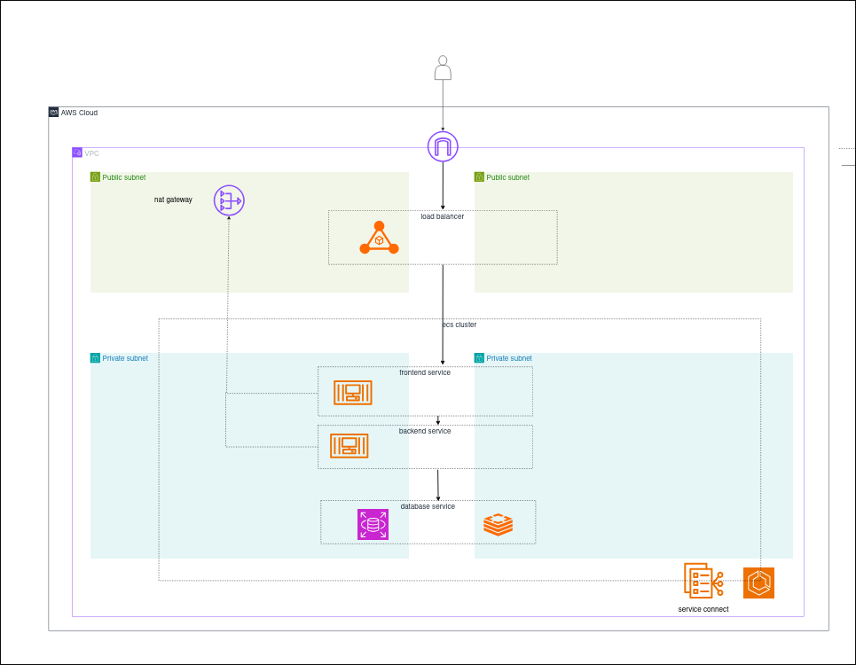
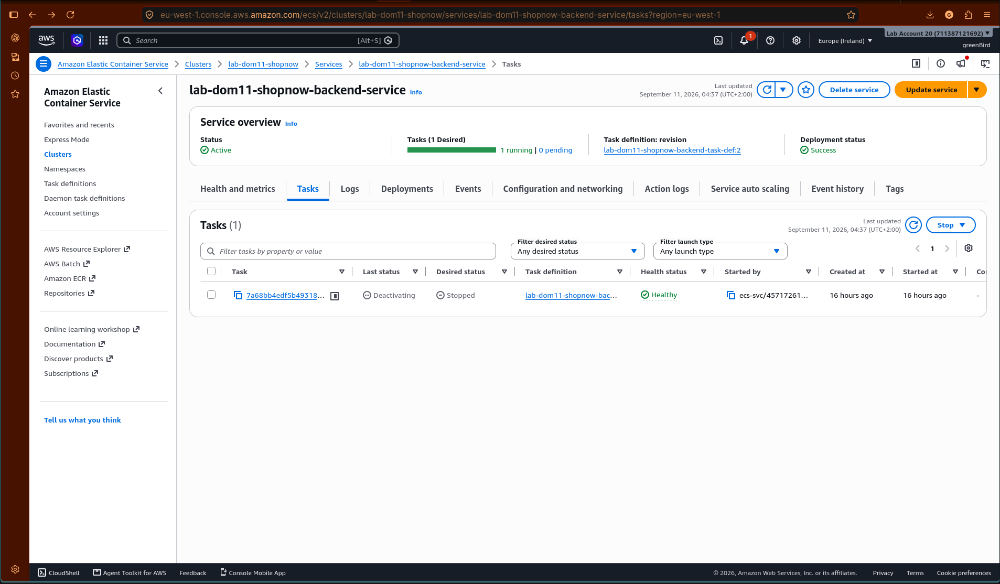
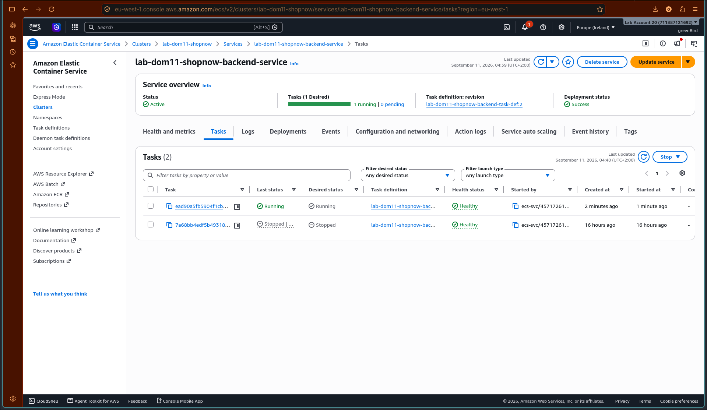

# lab-dom11-microservices: ShopNow

A four-tier e-commerce application (frontend, backend API, Redis, Postgres) deployed to both Amazon ECS Fargate and Amazon EKS, provisioned with Terraform. Both platforms share the same Amazon RDS (Postgres) and Amazon ElastiCache Serverless (Redis) backing stores.

## Architecture



A single VPC spans two Availability Zones, with two public and two private subnets. The only public-facing component is an Application Load Balancer, which forwards HTTP traffic to the `frontend` service. `frontend` and `backend` each run as their own ECS service in the private subnets, with no direct public access. Outbound internet access from the private subnets (image pulls, log shipping) goes through a single NAT Gateway.

`frontend` and `backend` communicate over **ECS Service Connect** (`shopnow-backend` client alias, proxied through an Envoy-based sidecar in each task). `backend` reaches Postgres and Redis directly by their real DNS endpoints - RDS and ElastiCache are managed services outside the ECS cluster, not ECS tasks, so there's no service discovery layer involved for the database tier.

### Kubernetes (EKS)

The same application also runs on an EKS cluster (`lab-dom11-shopnow-eks`), built from the same VPC's private subnets, with a managed node group and the AWS Load Balancer Controller installed via Helm (IRSA-authenticated, using an OIDC provider Terraform creates alongside the cluster). An `Ingress` object drives the same kind of Application Load Balancer the ECS side has, provisioned dynamically by the controller instead of by Terraform directly.

`backend` and `frontend` are plain Kubernetes Deployments/Services; Postgres and Redis are represented as `ExternalName` Services (`postgres`, `redis`) that DNS-alias straight to the real RDS/ElastiCache endpoints - no separate database pods, no persistent volumes to manage in-cluster.

Manifests live in `k8s/`; see that directory for the exact deploy sequence (Helm install, secret creation, `kubectl apply`).

## Components

| Service | Tech | Port | Role |
|---|---|---|---|
| `frontend` | Flask (server-rendered) | 3000 | Public UI: product grid, cart, checkout. Calls `backend` server-side; the browser never talks to `backend` directly. |
| `backend` | Flask (JSON API) | 8000 | `/api/products`, `/api/cart`, `/api/checkout`. Talks to Postgres and Redis. |
| Postgres | Amazon RDS (`postgres` 16) | 5432 | Product catalog and orders. |
| Redis | Amazon ElastiCache Serverless | 6379 | Cart storage, keyed by a cookie-issued cart ID with a TTL. No authentication configured; TLS is mandatory (ElastiCache Serverless enforces it) and handled via the backend's `REDIS_TLS` flag. |

Source: `app/frontend/`, `app/backend/`.

## Infrastructure (Terraform)

Root module: `iac/environments/sandbox/`. State is stored remotely in S3 with native S3 locking (`iac/environments/sandbox/providers.tf`).

| Module | Path | Creates |
|---|---|---|
| `networking` | `iac/modules/networking` | VPC, 2 public + 2 private subnets (one pair per AZ, tagged for EKS ELB discovery), Internet Gateway, 1 NAT Gateway, route tables |
| `ecr` | `iac/modules/ecr` | ECR repositories for the `backend`/`frontend` images (immutable tags, lifecycle policy, scan-on-push) |
| `eks` | `iac/modules/eks` | EKS cluster, managed node group, cluster/node IAM roles, OIDC provider, an IAM access entry granting the applying caller cluster-admin, and the IRSA role + policy for the AWS Load Balancer Controller |
| `security` | `iac/modules/security` | Security groups for the ALB and each ECS service, plus Postgres/Redis, with ingress scoped to exactly what needs to reach them - the ECS backend task and, separately, the EKS cluster's own security group |
| `secrets` | `iac/modules/secrets` | Generated passwords (Postgres, frontend session key) stored as SSM `SecureString` parameters |
| `iam` | `iac/modules/iam` | The shared ECS task execution role: ECR pull, CloudWatch Logs write/create, and scoped read access to the SSM parameters above |
| `rds` | `iac/modules/rds` | The Postgres instance and its DB subnet group |
| `elasticache` | `iac/modules/elasticache` | The Redis Serverless cache, open-access (no auth), TLS enforced by AWS regardless |
| `ecs` | `iac/modules/ecs` | The ECS cluster, the CloudWatch log group, the Cloud Map private DNS namespace, and the Application Load Balancer (listener + target group in front of `frontend`) |

## Task definitions and services

ECS task definitions are managed directly (not through Terraform) and live in `task-definitions/`: `lab-dom11-shopnow-{backend,frontend}-task-def.json`. Each references the execution role and SSM parameters produced by the Terraform modules above.

Each service runs on Fargate with one task in the private subnets, using the security group scoped to that component. Secrets (`PGPASSWORD`, `SECRET_KEY`) are injected via each container definition's `secrets` block, referencing the SSM parameters by name, never as plaintext values in the task definition. `PGHOST`/`REDIS_HOST` are the real RDS/ElastiCache DNS endpoints, set as plain environment variables.

## Local development

`app/docker-compose.yml` runs all four services locally, using local Postgres/Redis containers (not RDS/ElastiCache) for speed. Each service's configuration lives in its own env file (`postgres.env`, `backend.env`, `frontend.env`), and ports are bound to `127.0.0.1` only.

```bash
cd app
docker compose up -d --build
```

Redis has no authentication locally either, matching the deployed configuration. Postgres's healthcheck/`depends_on` chain ensures `backend` doesn't start until both are ready.

## Resiliency

**ECS**: the service scheduler maintains each service's desired task count automatically. Stopping a running task directly (bypassing any graceful shutdown) triggers ECS to launch a replacement without manual intervention:

| | |
|---|---|
|  |  |
| The running task is manually stopped | ECS immediately starts a replacement task |
|  | |
| The replacement reaches a healthy state, service returns to steady state | |

**EKS**: the same demonstration is `kubectl delete pod <backend-or-frontend-pod>` - the Deployment's controller notices the ReplicaSet has fewer pods than desired and schedules a replacement automatically, same mechanism as ECS's service scheduler, no screenshots captured yet.

## Repository structure

```
lab-dom11-microservices/
├── app/
│   ├── frontend/              Flask UI (templates, static assets, app.py)
│   ├── backend/                Flask API (routes/, db.py, cache.py)
│   ├── docker-compose.yml      Local four-service stack
│   └── *.env                    Per-service local configuration
├── iac/
│   ├── environments/sandbox/   Root Terraform module
│   └── modules/                   networking, ecr, eks, security, secrets, iam, rds, elasticache, ecs
├── task-definitions/            ECS task definition JSON, one per service
├── k8s/                           EKS manifests (Deployments, Services, Ingress, LB controller Helm values)
├── screenshots/                   Resiliency evidence
└── ecs_architecture.png           Architecture diagram
```
