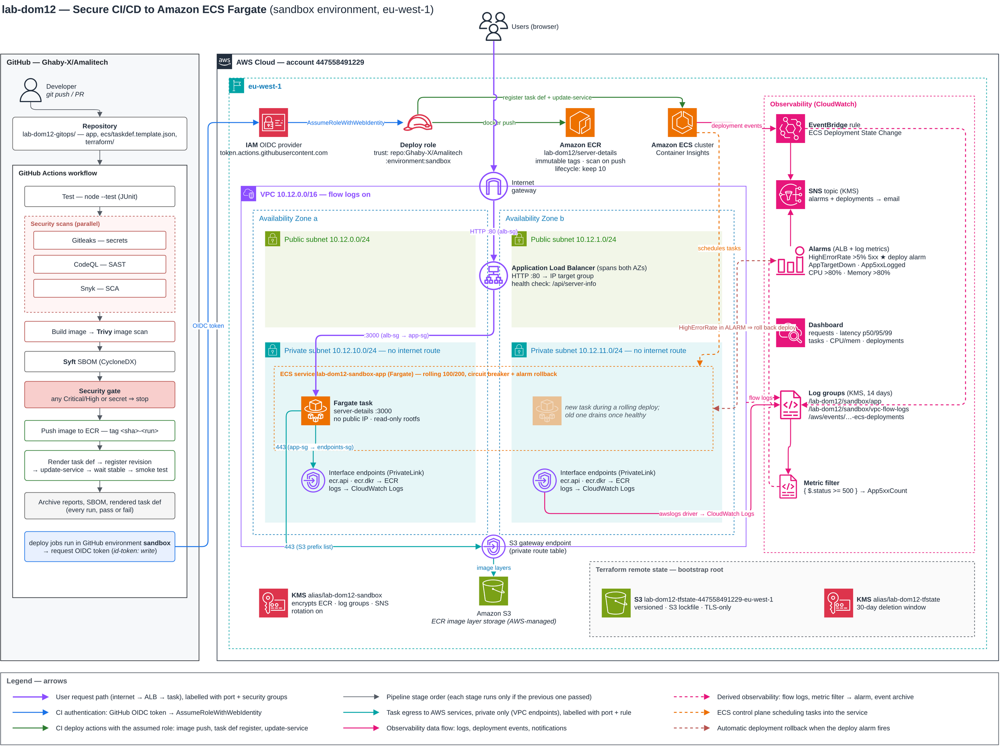
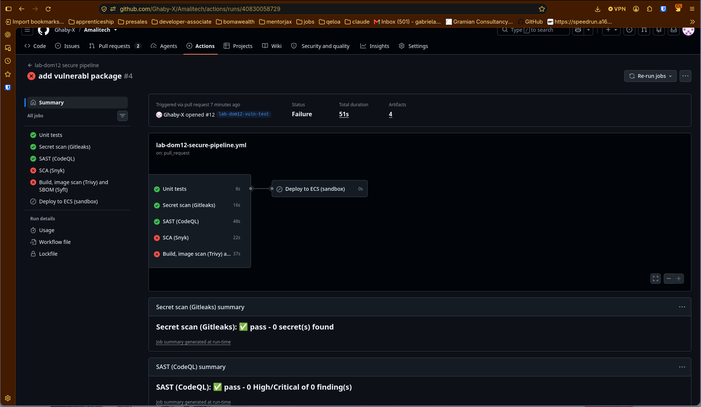
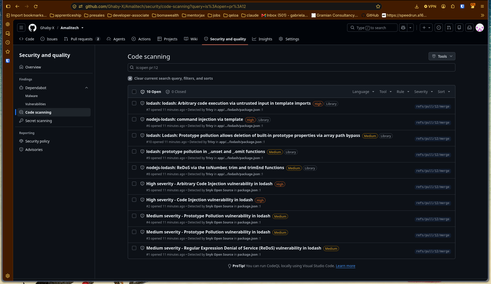
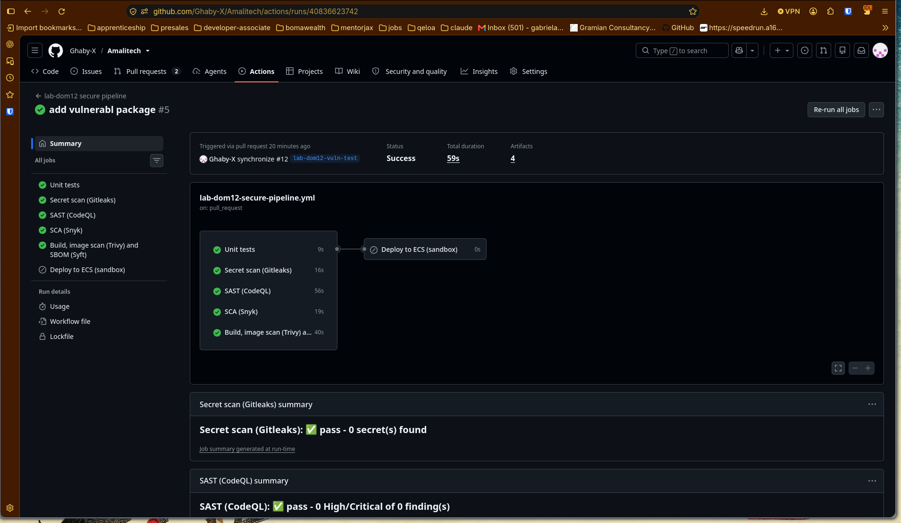
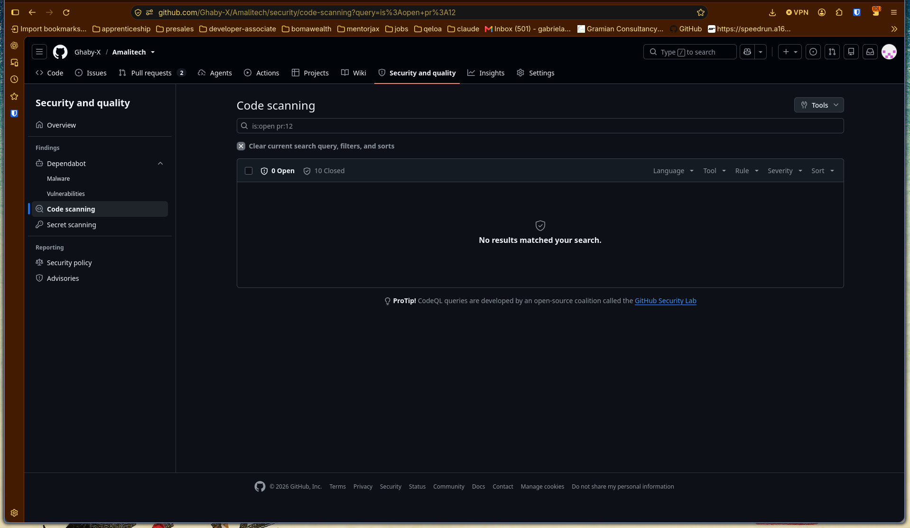
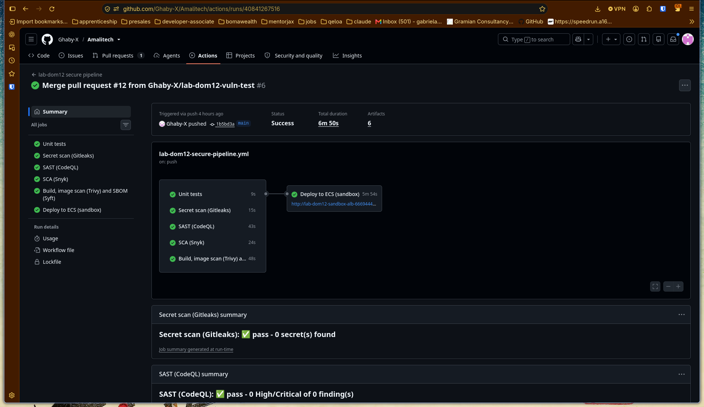
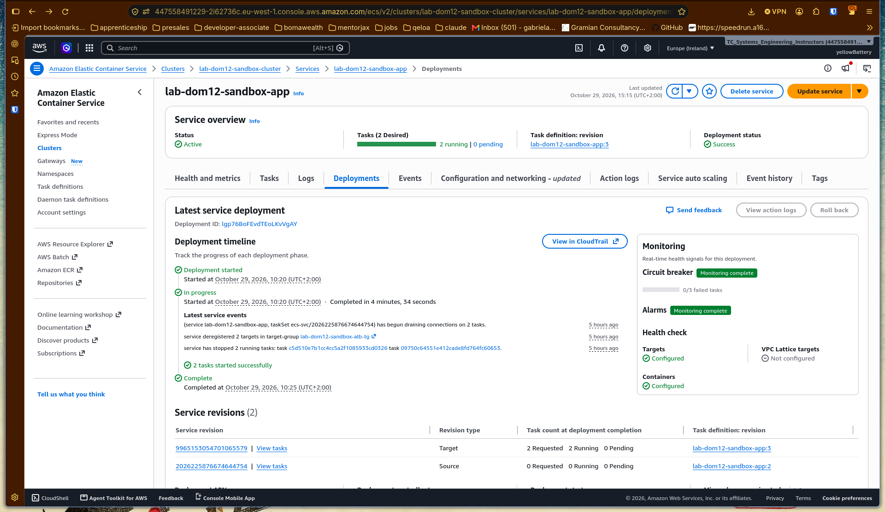

# Lab DOM12 - Secure CI/CD Pipeline (ECS + SAST/SCA)

A GitHub Actions pipeline that tests, scans and deploys a containerized Node.js
app to ECS Fargate. Every change goes through a secret scan, SAST, SCA, an
image scan and SBOM generation. A Critical/High finding or a leaked secret
fails the run and blocks the deploy. Images that pass are pushed to ECR with
an immutable versioned tag, deployed by digest as a new task definition
revision, and rolled out to the ECS service with alarm-based rollback.



## Contents

| Path | Purpose |
|---|---|
| [`app/`](app) | The app (Node.js 24, no framework), its tests and a hardened multi-stage `Dockerfile` |
| [`ecs/taskdef.template.json`](ecs/taskdef.template.json) | Task definition template, shared by Terraform (first revision) and the pipeline (every later revision) |
| [`scripts/`](scripts) | Pipeline helpers: render the task definition, verify tool downloads, wait for the rollout, collect evidence, clean up revisions |
| [`terraform/`](terraform) | `bootstrap/` (state bucket only), `environments/sandbox/`, and reusable `modules/` |
| [`../.github/workflows/lab-dom12-secure-pipeline.yml`](../.github/workflows/lab-dom12-secure-pipeline.yml) | The pipeline |
| [`reports/`](reports) | Archived security reports, SBOMs and deployment evidence for each demo run |
| [`screenshots/`](screenshots) | Run summaries, the Security tab and the ECS deployment |

## Pipeline

```
push / pull_request (lab-dom12-gitops/** paths)
 ├─ Unit tests ............ npm test
 ├─ Secret scan ........... Gitleaks over the pushed/PR commit range
 ├─ SAST .................. CodeQL (security-extended)
 ├─ SCA ................... Snyk (package-lock.json)
 └─ Build + image scan .... docker build → Trivy (vuln + secret) → Syft SBOM
        │
        └─ all green, main only ─▶ Deploy to ECS (sandbox)
              push to ECR → render task def → register revision
              → update-service → wait for COMPLETED → smoke test
              → evidence → clean up old revisions
```

The scan jobs run in parallel on every PR and push. `deploy` needs all of them
and runs only on `main`, in the `sandbox` GitHub environment, which only
accepts deployments from `main`.

### Security gates

| Gate | Tool | Fails the run on | Reports archived |
|---|---|---|---|
| Secrets | Gitleaks 8.30.1 | Any secret in the scanned commits | `gitleaks.sarif` |
| SAST | CodeQL (`security-extended`) | Any result with `security-severity` ≥ 7.0 (High/Critical) | `javascript.sarif` |
| SCA | Snyk CLI 1.1308.3 | Any High/Critical issue in the dependency tree | `snyk.json`, `snyk.sarif` |
| Image | Trivy 0.76.1 | Any HIGH/CRITICAL vulnerability, or any secret baked into the image | `trivy-image.{json,sarif,txt}` |
| SBOM | Syft 1.55.0 | Not a gate; generated before the image gate so blocked images still have one | `sbom.cdx.json` (CycloneDX) |

Each gate writes a pass/fail line to the run summary. Gitleaks, Snyk and Trivy
also upload SARIF to the repository's **Security → Code scanning** tab, next to
CodeQL. Reports are uploaded as artifacts even when a gate fails, so a blocked
run still leaves evidence behind.

### Pipeline hardening

- **Pinned dependencies.** Every action is pinned to a full commit SHA. The
  scanner binaries are downloaded by version and checked against a SHA-256
  hash in the workflow ([`scripts/install-tool.sh`](scripts/install-tool.sh))
  before they run. The `Dockerfile` pins the Node base image by digest.
- **Least privilege.** The workflow default is `permissions: {}`. Each job asks
  only for what it uses: `security-events: write` for SARIF uploads and
  `id-token: write` for the deploy job alone.
- **No long-lived AWS keys.** The deploy job assumes an IAM role through GitHub
  OIDC. The role's trust policy only accepts
  `repo:Ghaby-X/Amalitech:environment:sandbox`, and its permissions are scoped
  to this ECR repository, this ECS service, and `iam:PassRole` on the two task
  roles. The only repository secret is `SNYK_TOKEN`.
- **Scanned bytes are deployed bytes.** The image is built and scanned once,
  handed to the deploy job as an artifact, pushed, and deployed **by digest**
  (`repo@sha256:...`), so a tag can't be swapped in between.
- **Timeouts and concurrency.** Every job has `timeout-minutes`. Deploys are
  serialized and never cancelled midway.

## Images, task definitions and deployment

- **ECR:** tags are immutable, with scan-on-push and KMS encryption. Images
  are tagged `<short-sha>-<run>-<attempt>` (e.g. `1b5bd3a-6-1`).
- **Task definition:** [`scripts/render-taskdef.sh`](scripts/render-taskdef.sh)
  fills [`ecs/taskdef.template.json`](ecs/taskdef.template.json) from the
  GitHub environment's variables, synced from Terraform's `pipeline_config`
  output. Terraform renders the same template for the first revision.
- **Rolling deploy:** 2 Fargate tasks across two AZs behind the ALB, at
  100% minimum / 200% maximum. The circuit breaker and the `high-error-rate`
  deployment alarm both roll back automatically.
  [`scripts/wait-for-deployment.sh`](scripts/wait-for-deployment.sh) fails the
  job unless the rollout reaches `COMPLETED`.
- **Observability:**
  - **Logs:** the app's JSON access logs, VPC flow logs and ECS deployment
    events, all in CloudWatch Logs.
  - **Alarms:** five CloudWatch alarms send to SNS: `high-error-rate`,
    `app-target-down`, `app-5xx-logged`, `cpu-high` and `memory-high`. The
    deployment evidence records their state after every rollout.
- **Cleanup:**
  - **Task definitions:** [`scripts/cleanup-taskdefs.sh`](scripts/cleanup-taskdefs.sh)
    keeps the newest 5 revisions (plus any in use).
  - **Images:** the ECR lifecycle policy keeps the 10 most recent images and
    expires untagged ones after 1 day.
  - The demo only reached revision `:3`, so the cleanup removed nothing.

## Demo: blocking a vulnerable dependency

| # | Run | Change | Result | Evidence |
|---|---|---|---|---|
| 1 | [40828087831](https://github.com/Ghaby-X/Amalitech/actions/runs/40828087831) (PR #11 merged) | Baseline | All gates pass. Revision `:2` deployed, 2 healthy tasks, all alarms `OK` | [`reports/01-baseline-deploy`](reports/01-baseline-deploy) |
| 2 | [40830058729](https://github.com/Ghaby-X/Amalitech/actions/runs/40830058729) (PR #12) | Add `lodash@4.17.20` | **Blocked.** Snyk: 2 High + 3 Medium (incl. CVE-2021-23337). Trivy: 2 HIGH + 3 MEDIUM. Deploy skipped | [`reports/02-blocked-vuln-dep`](reports/02-blocked-vuln-dep) |
| 3 | [40836623742](https://github.com/Ghaby-X/Amalitech/actions/runs/40836623742) (PR #12) | Upgrade to `lodash@4.18.1` | All gates pass. The 10 code scanning alerts close | screenshots below |
| 4 | [40841267516](https://github.com/Ghaby-X/Amalitech/actions/runs/40841267516) (PR #12 merged) | Fixed code on `main` | Rolling update `:2` → `:3` `COMPLETED` in about 5 minutes, 2/2 targets healthy, all 5 alarms `OK` | [`reports/03-fixed-deploy`](reports/03-fixed-deploy) |

`4.17.21` is not enough as a fix: it still has CVE-2026-4800, which was fixed
in `4.18.0`. The dependency is pinned to an exact version.

### Screenshots

| | |
|---|---|
| Vulnerable dependency: Snyk and Trivy gates fail, deploy skipped |  |
| The same findings in the Security tab |  |
| After the fix: all gates pass on the PR |  |
| After the fix: the alerts are closed |  |
| Merge to `main`: gates pass and the deploy succeeds |  |
| ECS: rolling update from revision `:2` to `:3`, circuit breaker and alarms monitored |  |

### Reports layout

Each `reports/<run>/` holds the artifacts of that run:

```
report-gitleaks/gitleaks.sarif
report-codeql/javascript.sarif
report-snyk/snyk.{json,sarif}
report-trivy-sbom/trivy/trivy-image.{json,sarif,txt}
report-trivy-sbom/sbom/sbom.cdx.json
deploy-evidence/taskdef-<tag>.json      # rendered task definition (deploys only)
deploy-evidence/deployment-<tag>.json   # service, deployments, tasks, target health, alarms
```

## Infrastructure

Terraform `>= 1.15.8`, AWS provider `~> 6.70`, region `eu-west-1`.

- **`bootstrap/`** creates only the remote-state bucket: versioning, KMS, TLS
  only, S3-native locking (`use_lockfile`). Its own state is local.
- **`environments/sandbox/`** composes the modules:

| Module | What it creates |
|---|---|
| `security/kms_key` | One customer-managed key for ECR, CloudWatch Logs and SNS |
| `networking/vpc` | VPC, 2 public + 2 private subnets, VPC flow logs. No NAT gateway |
| `networking/vpc_endpoints` | Interface endpoints (ECR API/DKR, CloudWatch Logs) and an S3 gateway endpoint, so private tasks need no internet route |
| `networking/security_groups` | ALB → app → endpoints, each only from the previous hop |
| `networking/alb` | Internet-facing ALB, HTTP listener, target group with health check |
| `containers/ecr` | The repository and its lifecycle policy |
| `containers/ecs_service` | Cluster (Container Insights), execution/task roles, log group, first task definition, service |
| `observability/monitoring` | Alarms, log metric filter, SNS topic, EventBridge deployment events, dashboard |
| `security/github_deploy_role` | The OIDC deploy role (uses the account's existing GitHub OIDC provider) |

The S3 gateway endpoint policy only allows `s3:GetObject` on
`prod-eu-west-1-starport-layer-bucket`, the AWS-owned bucket ECR serves image
layers from. That is the only S3 access the tasks need.

## Running it

```bash
# 1. State bucket (once)
cd terraform/bootstrap && terraform init && terraform apply

# 2. Environment
cd ../environments/sandbox && terraform init && terraform apply

# 3. Give the pipeline its configuration (GitHub environment "sandbox")
cd ../../.. && scripts/sync-github-env.sh sandbox Ghaby-X/Amalitech
gh secret set SNYK_TOKEN --repo Ghaby-X/Amalitech

# 4. Open a PR touching lab-dom12-gitops/ - gates run; merge to main - deploy runs
```

Then create the `sandbox` environment in the repository settings, restricted
to the `main` branch. The OIDC role trusts that environment only.

Local checks:

```bash
cd app && npm ci && npm test
docker build -t lab-dom12:local app
```

### Teardown

```bash
cd terraform/environments/sandbox && terraform destroy
```

The ECR repository has `force_delete = true` in the sandbox, so its images go
with it. Task definition revisions registered by the pipeline aren't in
Terraform state: deregister or delete them with `scripts/cleanup-taskdefs.sh`
or the console if needed. The bootstrap bucket has `prevent_destroy`, so remove
that line first if the state bucket should go too.
